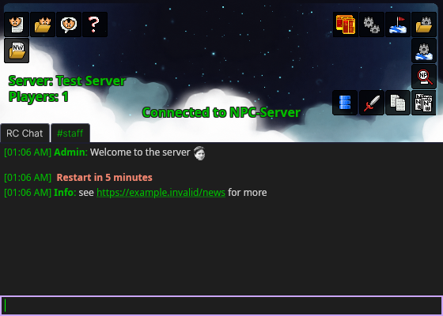
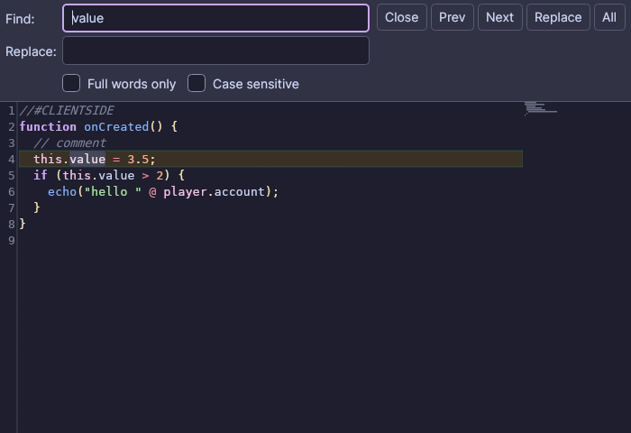
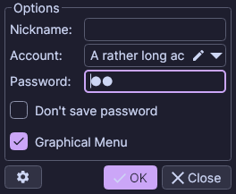
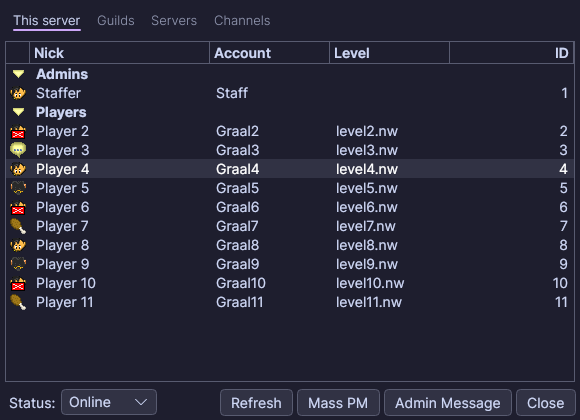
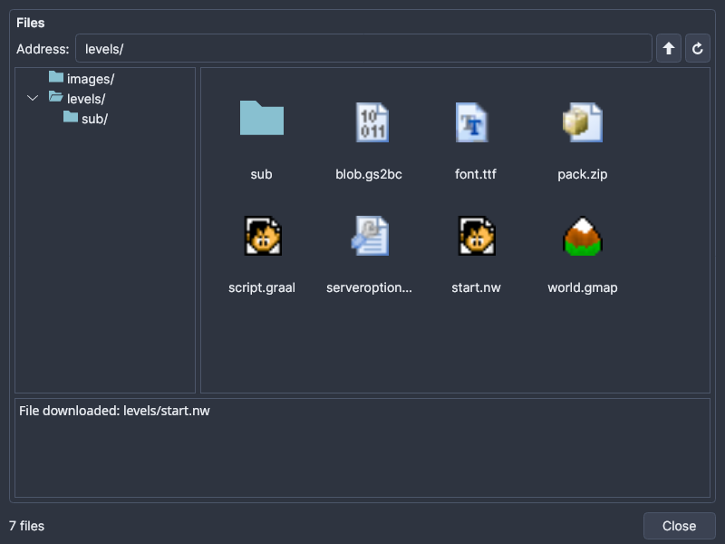

<div align="center">

# Remote Control

**The Graal Remote Control, rewritten in C#: one program for Windows and Linux to run a game server from.**<br>
RC chat, players, accounts and bans, a file browser, sync with git backups, and a script editor over the NPC-Control: with the
Alpaxis list server built in, and any other network one setting away.

[Download](https://github.com/AlpaxisNet/RemoteControl/releases/latest) ·
[Sign in](#sign-in) ·
[What it does](#what-it-does) ·
[Your files](#your-files) ·
[Build and test](#build-and-test) ·
[Extensions](docs/EXTENSIONS.md) ·
[For contributors](AGENTS.md)




</div>

## What it is

Remote Control (RC) is the staff tool of Graal Online style game servers. This one is a complete rewrite in C# of
[GScript.RemoteControl](https://github.com/MorenoLand/GScript.RemoteControl), a C++/GTK3 client, and of the C library it stood on,
[GScript.RClib](https://github.com/MorenoLand/GScript.RClib). The windows, the options and the files are the ones its users know;
what changed is underneath:

- **One program, nothing to install.** .NET 8 and Avalonia instead of GTK3: a single executable with .NET inside, for Windows and
  Linux, that signs in to several servers at once.
- **Built not to crash.** The C++ crashed at random, and a review found why: network sends without a lock, events delivered to
  windows that were gone, a connection used after it was freed, packets trusted to be well formed, slow work on the
  user-interface thread. The rewrite is built on eight rules that rule each of these out ([AGENTS.md](AGENTS.md)), and it is
  tested: every window runs in tests without a screen.
- **For the Alpaxis network, and any other.** The built-in list server is Alpaxis (`listserver.alpaxis.net`); your own list
  servers are added in the settings, and an account's password only ever goes to the list server it was saved for.
- **Your files stay yours.** Options, saved accounts and list-server profiles of the C++ version are read as they are.

| | |
| --- | --- |
| Code | about 54,000 lines of documented C# in 14 libraries, 23,000 lines of tests |
| Tests | **1,473**, all without a network, a screen or the user's files; two more run on request against a test network of your own |
| Systems | Windows 10 and 11 (x64), Linux (x64, X11 or XWayland); packages built by GitHub Actions on every tag |
| Network | the list server, the RC and NC connections and their file transfers in managed code; tried live against an Alpaxis network |

## Get started

**Download** the package for your system from the [latest release](https://github.com/AlpaxisNet/RemoteControl/releases/latest),
unpack it anywhere and start `RemoteControl` (`RemoteControl.exe`):

```bash
tar -xzf RemoteControl-1.1.1-linux-x64.tar.gz && cd RemoteControl-1.1.1-linux-x64 && ./RemoteControl
```

The folder holds the program, the few native libraries of the user interface, and `images/`, `sounds/`, `fonts/`,
`language-specs/` and `control2config.txt` (the default options), all of which you may change. On Linux it needs what every
desktop has: X11 (or XWayland), fontconfig and a font; the tray icon needs a StatusNotifier host (KDE has one, GNOME needs the
AppIndicator extension that Ubuntu ships).

### Sign in



The login window takes a nickname, an account and its password. Accounts can be saved (encrypted, in your user folder) together
with the list server they belong to.

**List servers.** A list server is where accounts are checked and where the server list comes from. One is built in: **Alpaxis**
(`listserver.alpaxis.net`, port 14922). It is always there and cannot be changed. For another network, open the list-server
settings (the gear in the login window or in the server list) and add its name, host and port; your own entries can be edited,
reordered and removed. If an account was saved for a list server that is no longer among your profiles, the program asks which
one to use before it sends anything.

**Direct mode** connects an account straight to a game server's host and port, without a list server.

Each server you join gets a main window of its own, and the tray icon lists them. Closing a main window hides it when there is a
tray icon (the session stays signed in) and asks before signing out when there is none.

## What it does




| | |
| --- | --- |
| **Chat** | the RC chat, the NC chat, IRC channels and extension output in tabs; time stamps, alerts, emotes, links, `@mention` and command completion, a find bar, a chat log file |
| **Players** | the player list with other servers, guilds and channels; private and mass messages with history; attributes, rights, comments, account, profile, warp, disconnect, reset; bans in the old and the new form with their history; the accounts list |
| **Scripts** | weapons, classes, database NPCs and levels over the NC; an editor with highlighting, live checking, completion from a script API description, hover and signature help, formatting, find and replace, a minimap; an external editor with upload on save. An editor counts as saved only when the text really went to the server, and closing one with changes asks |
| **Server settings** | server options, server flags and folder configuration as text |
| **Files** | a file browser as a list or as icons, with previews: upload (also by dropping files from the file manager, on Windows and on Linux), download, rename, move, delete, edit, open with the desktop's program and upload again when the file changes |
| **Server Backup** | Files → Server Backup downloads every file the account may read into a folder of your choice, in the server's folders (`levels/start.nw` goes to `levels/start.nw`); running it again fetches only what changed, keeps the earlier copy of a changed file in `.earlier-copies/`, and never deletes anything |
| **Import Missing** | Files → Import Missing (also a button in the file browser) asks the server which files its levels, NPCs, weapons, classes and animations name and it does not have, together with the server folder each belongs in, looks for files of those names under a folder of your computer (such as your UGD) in every subfolder, and lists them: the kind of file, where it is used, the server's folder, the local file and why a row is not ticked. Where several local files have the name, the one in a folder named like the kind (`heads`, `images`, ...) is chosen and "Other file..." picks another. After you confirm how many files and how many bytes go to which server, the ticked files are uploaded one after the other, each with the server's answer in its row. It needs a game server that knows the request (otherwise the window says so after 60 seconds), the right to update levels, and a folder right with `w` for each folder it uploads into. It uploads only what you ticked and confirmed, and it replaces no file on the server, since it offers only files the server reports missing. It guesses no name that a script builds while it runs (`"head" @ id @ ".png"`): the server leaves those out, so they are not listed. The folder you searched is remembered in the option `importmissingfolder` |
| **Sync and git backups** | keeps a local folder and the server's files, scripts and configuration in step, one way or both, with exclusions, conflicts that lose nothing, deletions only with permission, and git commits and pushes |
| **Extensions** | packages in an `extensions` folder that run beside the program and talk to it in JSON lines ([docs/EXTENSIONS.md](docs/EXTENSIONS.md)) |
| **MCP** | `RemoteControl --mcp` is an MCP server over standard input and output that drives the running program (servers and windows, script editors, chat), with approvals and an audit log; off until you switch it on |
| **Looks** | thirteen themes, the classic picture header with your own pictures and background (animated WebP and GIF too), colours and fonts in the options |

Command line: `--debug` prints the program's log to standard error, `--packetlog` also prints every packet, `--mcp`
(`--mcp-instance N`) runs the MCP server.

## Your files

Everything of yours is in one folder: `%LOCALAPPDATA%\GScriptRC` on Windows, `~/.config/GScriptRC` on Linux (`XDG_CONFIG_HOME` is
honoured). The folder keeps the name the C++ version used, so its users find their accounts and settings where they left them.

| File or folder | What it is |
| --- | --- |
| `control2config.txt` | the options (`key=value`); the first start copies the defaults from beside the program |
| `accounts.key`, `accounts.dat` | the saved accounts, encrypted (AES-256-GCM) with a key that never leaves this folder |
| `listservers.conf` | your own list servers (`name<TAB>host<TAB>port`); Alpaxis is built in and not in this file |
| `logs/` | the chat log (when switched on), the program's log and `crash.log` |
| `PMs/` | private-message history, one file per account |
| `Downloads/`, `ExternalEditor/`, `cache/`, `extensions/` | downloaded files, the external editor's workspace, previews and editor data, your extensions |

A file the program cannot read is never overwritten: it is kept, and you are told.

## Build and test

You need the .NET 8 SDK and nothing else.

| | Command |
| --- | --- |
| Build | `dotnet build RemoteControl.sln -c Release` (0 warnings; warnings are errors) |
| Test | `dotnet test RemoteControl.sln -c Release --no-build` |
| Packages | `scripts/publish.sh` (Linux, macOS, Git Bash) or `scripts/publish.ps1` (Windows): `publish/<system>/` and an archive for each of `linux-x64` and `win-x64`; name other systems as arguments |

The tests need no network, no screen and none of your files: the window tests draw into memory, and a test can never start a
browser or any other program on your desktop. Two tests talk to a real network and run only when you name one
(`RC_LIVE_LISTSERVER=host:port`, `RC_LIVE_ACCOUNT`, `RC_LIVE_PASSWORD_FILE`, optionally `RC_LIVE_SERVER`): use a test network of
your own. GitHub Actions builds and tests every push on Linux and Windows ([build.yml](.github/workflows/build.yml)) and
publishes the packages of every `v*` tag as a release ([release.yml](.github/workflows/release.yml)).

## Repository

| Path | What it is |
| --- | --- |
| [`src/RemoteControl.Protocol`](src/RemoteControl.Protocol) | the network: the list server, the RC and NC connections, file transfers, the texts users edit (rights, accounts, attributes, bans) |
| [`src/RemoteControl.Core`](src/RemoteControl.Core) | settings and storage: options, saved accounts, list-server profiles, paths, the crash log |
| [`src/RemoteControl.Scripting`](src/RemoteControl.Scripting) | the script language: checking, formatting, completion, find and replace, highlighting definitions |
| [`src/RemoteControl.Extensions`](src/RemoteControl.Extensions), [`src/RemoteControl.Sync`](src/RemoteControl.Sync) | extension packages and the MCP server; synchronisation and git backups: each without its windows |
| [`src/RemoteControl.Ui.Common`](src/RemoteControl.Ui.Common), [`src/RemoteControl.Ui.Shell`](src/RemoteControl.Ui.Shell) | what every window shares (themes, pictures, controls, dialogs, error handling) and what the groups of windows agree on (sessions, the tool registry) |
| [`src/RemoteControl.Ui.*`](src) | one library per group of windows: `Start` (login, server list, list servers), `Session` (main window, options), `Players`, `Scripts`, `Files`, `Extensions` |
| [`src/RemoteControl.App`](src/RemoteControl.App) | the program: start-up, sessions, the tray icon, the global hotkey, the MCP host |
| [`tests/`](tests) | one test project per library, the fake servers and the screenless test kit they share |
| [`assets/runtime`](assets/runtime) | pictures, sounds, fonts, language files and the default options, copied beside the executable |
| [`scripts/`](scripts), [`.github/workflows`](.github/workflows) | packaging, and the builds GitHub runs |

## Documentation

- [AGENTS.md](AGENTS.md): how the code is laid out and the rules every change keeps, for people and agents alike
- [docs/EXTENSIONS.md](docs/EXTENSIONS.md): writing, packaging and debugging extensions

## What is different from the C++ version

On purpose:

- Ban History, Staff Activity, Edit Access and saving a ban first send the server's "client RC" request (the one the in-game RC
  sends), once per connection. An Alpaxis game server from before 2026-11-19 answers ban texts only after it, drops them without a
  word otherwise, and shows the other staff "New RC: … (in the client)" the first time. A newer one answers this program's ban
  texts in any case and announces nothing; the request is still sent for the servers that were not updated. A player of another server gets the short menu of the Servers tab, and a player
  who left is offered nothing that goes by the player id they had (the server may have given it to someone else).
- Edit Access sends a new ban, or a reset ban time, with the length of its ban type (the C++ sent none; Alpaxis then takes the
  type's own length, and bans nothing when it does not know the type) and a ban that is kept with the seconds left now; it asks
  before a ban without an end when a type's length is not known and sends that ban with the length 0, which Alpaxis reads as no
  end, and it asks before banning again a ban that ended while the window was open. A ban keeps its own type even when the server's list
  does not have it. Admin messages appear as alert lines in the RC chat.

- The built-in list server is Alpaxis; the C++ inserted a "Retail" profile for another network by itself. A profile of your own
  with that name stays as it is.
- Deleting an account, a file, a script, an NPC or an extension asks first. After a disconnect the main window stays and offers to
  reconnect.
- A download never overwrites a different local copy (the old one is moved aside), and a server's file name can never leave the
  download or sync folder. A double click in the file browser hands only harmless files to the desktop; scripts and programs open
  in the text editor.
- Sync remembers what was last synchronised, so an edit made while the program was closed is not overwritten; a conflict keeps
  your file and puts the server's copy into `.graal-sync/conflicts/`; more than ten deletions at once wait for your confirmation.
  A folder the server does not open for the account any more stays among the folders you chose (the log says so): only a folder
  that is really empty leaves them.
- HTML in private messages is shown as text; nothing is ever loaded from the network for a message.
- On Windows the options, logs and message history moved from the program's folder to the user folder (the old options file is
  read once and copied).
- With the Alpaxis servers in mind: NC lists (class scripts, NPC flags, levels) are sent one line per string, a frame is at most
  32767 bytes (a larger one is refused with a message, never cut), uploads go in pieces of 32000 bytes.

Not there yet:

- Dragging files out of the file browser onto the desktop (dropping files in to upload, and moving files between folders inside
  the window, work).
- Rounded window corners (the desktop draws the window frame), reordering chat tabs by dragging, resizable columns in some lists.
- Several carets in the script editor type and delete together, but cursor movement, copy and paste use the main caret only.
- The global hotkey works on Windows and X11, not on Wayland or macOS.
- "Attach away" at the start of a session, and GTK icon names for extension buttons (a picture file works).
- macOS has never been tried; the code has no part that is against it (`scripts/publish.sh osx-arm64`).

## Credits

- The original RemoteControl was created by **Stefan Knorr** for Graal Online. This project is independent and unaffiliated.
- This program is a rewrite of **[GScript.RemoteControl](https://github.com/MorenoLand/GScript.RemoteControl)** and
  **[GScript.RClib](https://github.com/MorenoLand/GScript.RClib)** by MorenoLand, whose behaviour, file formats, pictures and
  extension guide it keeps. Thank you.
- Built with [.NET](https://dotnet.microsoft.com), [Avalonia](https://avaloniaui.net),
  [AvaloniaEdit](https://github.com/AvaloniaUI/AvaloniaEdit) and [SharpZipLib](https://github.com/icsharpcode/SharpZipLib).

## License

The source code is MIT licensed ([LICENSE](LICENSE)). Graal Online and its content belong to their owners: the artwork, logos and
other supplied runtime assets in `assets/runtime` remain the property of their respective owners.
